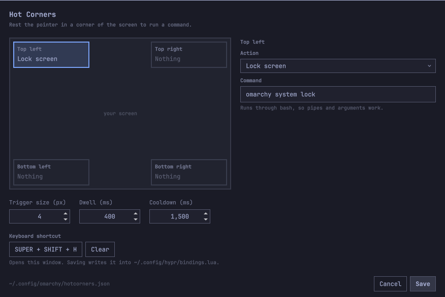

# Hot Corners for Omarchy

macOS-style hot corners for [Omarchy](https://omarchy.org/). Rest the pointer in
a corner of the screen for a moment and a command runs — lock the screen, open
the menu, start the screensaver, or anything else you can type into a shell.

Includes a settings GUI, themed like the rest of the Omarchy shell, an accent
glow that grows while a corner arms, and two ways to keep corners from firing
by accident.



## Requirements

Omarchy 4 (the Quickshell-based shell) and Hyprland. No other dependencies —
the plugin is two QML files, a JS module, and two shell scripts, and every
action it offers is a command Omarchy already ships.

## Install

```bash
omarchy plugin add https://github.com/abdul/omarchy-hotcorners.git --enable --yes
omarchy restart shell
```

Plugins run as unsandboxed code inside `omarchy-shell`, so read the source
before you enable it — it is two QML files and a JS module.

## Use

Open the settings GUI:

```bash
omarchy-shell hotcorners-settings toggle
```

Pick a corner in the diagram, choose an action (or type your own command), and
Save. Changes apply immediately — no restart.

### Making it reachable

The GUI can set its own keyboard shortcut: click the shortcut button, press the
combination you want, and Save. The plugin writes it into a clearly marked
block in `~/.config/hypr/bindings.lua` and reloads Hyprland:

```lua
-- >>> hotcorners (managed by the hotcorners plugin) >>>
o.bind("SUPER + SHIFT + H", "Hot corners", "omarchy-shell hotcorners-settings toggle")
-- <<< hotcorners <<<
```

Nothing outside those markers is touched, re-saving replaces the block rather
than stacking up duplicates, and clearing the shortcut removes it. You can also
set it without opening the GUI:

```bash
omarchy-shell hotcorners-settings shortcut "SUPER + SHIFT + H"
omarchy-shell hotcorners-settings shortcut ""     # remove it
```

A menu entry is still yours to add — installing a plugin never edits your
config, and the Omarchy menu only reads its own default file plus your
extension file. To get one under Setup, add this to
`~/.config/omarchy/extensions/omarchy-menu.jsonc` (it hot-reloads on save):

```jsonc
"setup.hotcorners": {"icon":"⬚","label":"Hot corners","when":"[[ -e ~/.config/omarchy/plugins/abdul.hotcorners ]]","action":"omarchy-shell hotcorners-settings toggle"}
```

The `when` clause hides the row if the plugin is ever removed.

## Actions

The dropdown offers the macOS hot corner actions, mapped to their Omarchy
equivalents:

| macOS | Here |
|-------|------|
| Lock Screen | `omarchy system lock` |
| Start Screen Saver | `omarchy launch screensaver` |
| Put Display to Sleep | `hyprctl dispatch 'hl.dsp.dpms("off")'` |
| Notification Center | `omarchy-shell notifications showHistory` |
| Launchpad | `omarchy menu toggle apps` |
| Mission Control | — |
| Application Windows | *Cycle windows*, roughly |
| Desktop | — |
| Quick Note | — |

Plus what Omarchy and Hyprland offer that macOS does not have a corner for:
next / previous / last-used workspace, toggle the scratchpad, cycle windows,
the Omarchy and system menus, clipboard history, the emoji picker, a region
screenshot, and night light. Anything else goes in the free-text field.

**Mission Control has no equivalent.** Hyprland ships no window overview;
`hyprexpo` and `hyprtasking` are out-of-tree plugins it does not load by
default. If you install one, add its dispatcher as a custom command — the
field takes any shell command. *Cycle windows* is the nearest built-in, and it
steps through windows one at a time rather than showing them all at once.

Note on *Put display to sleep*: this is real DPMS, so any mouse movement or
keypress wakes it — including the movement that carries the pointer out of the
corner. It is included for parity, but *Lock screen* already turns the display
off and is usually what you want.

### Hyprland dispatchers

Hyprland 0.56 configures in Lua, so `hyprctl dispatch` takes a Lua expression
rather than the older `dispatcher argument` form. A custom command that needs a
dispatcher looks like this:

```bash
hyprctl dispatch 'hl.dsp.focus({ workspace = "e+1" })'
hyprctl dispatch 'hl.dsp.workspace.toggle_special("scratchpad")'
```

`hyprctl dispatch dpms off` — the pre-Lua form — silently fails with a Lua
syntax error, so check anything you copy from an older guide.

## Configuration

The GUI writes `~/.config/omarchy/hotcorners.json`, which is equally fine to
hand-edit — the plugin watches it and reloads on save. It is created with every
corner disabled the first time the plugin runs.

```json
{
  "version": 1,
  "triggerSize": 4,
  "dwellMs": 400,
  "cooldownMs": 1500,
  "shortcut": "SUPER + SHIFT + H",
  "requireSuper": false,
  "suppressFullscreen": true,
  "glow": true,
  "corners": {
    "top-left":     { "action": "omarchy system lock" },
    "top-right":    { "action": "" },
    "bottom-left":  { "action": "" },
    "bottom-right": { "action": "omarchy menu" }
  }
}
```

| Key | Meaning |
|-----|---------|
| `triggerSize` | Size of the corner trigger square, in pixels (1–40). |
| `dwellMs` | How long the pointer must rest in the corner before firing (0–3000). |
| `cooldownMs` | Ignore re-entry for this long after a corner fires (0–10000). |
| `shortcut` | Keybinding that opens the GUI, e.g. `SUPER + SHIFT + H`. Empty means none. |
| `requireSuper` | Corners only fire while Super is held. Off by default. |
| `suppressFullscreen` | Do not fire while a window is fullscreen. On by default. |
| `glow` | Show the accent bloom that grows while a corner arms. On by default. |
| `corners.<corner>.action` | Command to run, via `bash -lc`. Empty disables the corner. |

An empty action collapses that corner to nothing: it takes no pointer input at
all, so it cannot fire and cannot get in the way.

A malformed config falls back to the defaults rather than taking the shell
down with it.

## Commands

```bash
omarchy-shell hotcorners status              # actions, timings, live trigger rects
omarchy-shell hotcorners trigger top-left    # run a corner's action now
omarchy-shell hotcorners configPath          # where the config lives
omarchy-shell hotcorners-settings toggle     # open/close the settings GUI
omarchy-shell hotcorners-settings shortcut "SUPER + SHIFT + H"
```

## How it works

One transparent layer-shell surface per screen, with its input region masked
down to just the enabled corner squares. Everything outside those squares is
click-through, so the surface is invisible to the rest of your session. A
`MouseArea` starts the dwell timer on enter and cancels it on exit; the pointer
must leave the corner before it can fire again.

## Not firing by accident

Two ways to stop a corner going off when you did not mean it, both in the
GUI's Behaviour section:

**Ignore fullscreen windows** (on by default) — a corner will not fire while a
window is fullscreen, so parking the pointer during a video is safe. State
comes from Hyprland's event stream, not a polling loop.

**Hold Super to arm** (off by default) — corners fire only while Super is
held, which also means dragging a window into an edge cannot trip one. Turning
it on adds two binds to the managed block in `bindings.lua`:

```lua
o.bind("Super_L", "Arm hot corners", "omarchy-shell -q hotcorners arm 1", { non_consuming = true })
o.bind("Super_L", "Disarm hot corners", "omarchy-shell -q hotcorners arm 0", { release = true, non_consuming = true })
```

`non_consuming` is what keeps `SUPER + <key>` working — without it these binds
swallow the Super press and every Super shortcut on the system stops firing.

The cost is honest: each Super press and release spawns a short-lived process.
That is why it is opt-in rather than the default. If you use Super constantly
and would rather not pay for it, leave it off — the dwell delay alone already
stops most accidental triggers, since throwing the pointer at a corner and
clicking is faster than the dwell.

## Notes and limitations

- **The top corners sit over the bar.** Whatever lands in the trigger square
  stops reaching the bar, so a top-left corner costs the Omarchy menu button
  its outermost few pixels. Keep `triggerSize` small, prefer the bottom
  corners, or turn on Hold Super to arm.
- **Every screen gets its own corners**, at that screen's own edges.
- **Editing the QML needs `omarchy restart shell`.** The QML engine caches
  plugin components by path, so a plain reload keeps the old version. Config
  changes need no restart — only code changes do.

## Removing it

`omarchy plugin remove` deletes the plugin folder but runs no hooks, so undo
the things this plugin wrote outside its own directory first:

```bash
~/.config/omarchy/plugins/abdul.hotcorners/bin/uninstall.sh
omarchy plugin remove abdul.hotcorners
```

`uninstall.sh` removes the managed keybinding block from your Hyprland config,
reloads Hyprland, and deletes `~/.config/omarchy/hotcorners.json`. Pass
`--keep-config` to keep your settings. A menu entry, if you added one, is
yours to delete.

## What it writes

Only these, and nothing else:

| Path | When |
|------|------|
| `~/.config/omarchy/hotcorners.json` | Created with every corner disabled on first run; rewritten when you Save. |
| `~/.config/hypr/bindings.lua` | Only when you set or clear the shortcut, and only inside its own marked block. |

The Hyprland config is never touched unless you deliberately change the
shortcut — an ordinary Save that leaves it alone does not rewrite it. The edit
is confined to the block between the plugin's own markers; everything else in
the file is left byte-for-byte intact, which you can check with `git diff` if
you keep your dotfiles in git.

## License

MIT. See [LICENSE](LICENSE).
